

<picture><source media="(prefers-color-scheme: dark)" srcset="assets/hero-dark.svg"></picture>

<picture><source media="(prefers-color-scheme: dark)" srcset="assets/social-l-dark.svg"></picture><a href="https://t.me/k1rvl_01"><picture><source media="(prefers-color-scheme: dark)" srcset="assets/social-1-dark.svg"></picture></a><picture><source media="(prefers-color-scheme: dark)" srcset="assets/social-r-dark.svg"></picture>

<picture><source media="(prefers-color-scheme: dark)" srcset="assets/about-dark.svg"></picture>

<picture><source media="(prefers-color-scheme: dark)" srcset="assets/stack-dark.svg"></picture>

<a href="https://github.com/k1rvl07/warpdrop"><picture><source media="(prefers-color-scheme: dark)" srcset="assets/project-warpdrop-dark.svg"></picture></a>&nbsp;<a href="https://github.com/k1rvl07/QuipuChip"><picture><source media="(prefers-color-scheme: dark)" srcset="assets/project-quipuchip-dark.svg"></picture></a>

<a href="https://github.com/k1rvl07/tandem-frontend"><picture><source media="(prefers-color-scheme: dark)" srcset="assets/project-tandem-frontend-dark.svg"></picture></a>&nbsp;<a href="https://github.com/k1rvl07/tandem-backend"><picture><source media="(prefers-color-scheme: dark)" srcset="assets/project-tandem-backend-dark.svg"></picture></a>

<a href="https://github.com/k1rvl07/404chan-frontend"><picture><source media="(prefers-color-scheme: dark)" srcset="assets/project-404chan-frontend-dark.svg"></picture></a>&nbsp;<a href="https://github.com/k1rvl07/404chan-backend"><picture><source media="(prefers-color-scheme: dark)" srcset="assets/project-404chan-backend-dark.svg"></picture></a>

<picture><source media="(prefers-color-scheme: dark)" srcset="assets/stats-dark.svg"></picture>

<picture><source media="(prefers-color-scheme: dark)" srcset="assets/streak-dark.svg"></picture>

<picture><source media="(prefers-color-scheme: dark)" srcset="assets/wave-dark.svg"></picture>

<a href="https://github.com/k1rvl07?tab=repositories"><picture><source media="(prefers-color-scheme: dark)" srcset="assets/button-1-dark.svg"></picture></a>

<a href="https://metawka.github.io/expressive-profile/?from=k1rvl07"><picture><source media="(prefers-color-scheme: dark)" srcset="assets/credit-dark.svg"></picture></a>

